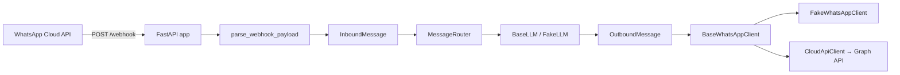

<p align="center"></p>

<h1 align="center">WhatsApp AI Bot</h1>

<p align="center">
  <strong>A FastAPI webhook for the WhatsApp Cloud API that routes inbound messages to an LLM and replies — with deterministic offline fakes so it runs and tests without any network or API keys.</strong>
</p>

<p align="center">
  <em>Built and maintained by <a href="https://viprasol.com">Viprasol Tech</a> — Fintech Experts. Full-Stack Builders.</em>
</p>

<p align="center">
  <a href="https://github.com/Viprasol-Tech/whatsapp-ai-bot/actions/workflows/ci.yml"></a>
  <a href="LICENSE"></a>
  
  <a href="https://github.com/astral-sh/ruff"></a>
  <a href="https://t.me/viprasol_help"></a>
  <a href="https://github.com/Viprasol-Tech/whatsapp-ai-bot/stargazers"></a>
</p>

---

> ### ℹ️ Offline-first by design
> The **LLM** and the **WhatsApp client** are both abstract interfaces (`BaseLLM`, `BaseWhatsAppClient`). The package ships deterministic fakes (`FakeLLM`, `FakeWhatsAppClient`) so the demo and the **entire test suite run with no network, no API keys, and no heavy SDKs**. Wire in the real WhatsApp Cloud API sender and your model of choice for production.

---

## ✨ Features

- 📩 **WhatsApp Cloud API webhook** — `GET /webhook` verify-token handshake plus `POST /webhook` inbound message handling.
- 🧠 **LLM-backed routing** — a `MessageRouter` sends each message to a pluggable LLM and formats the reply.
- 🤖 **Deterministic `FakeLLM`** — stable, network-free responses for demos and tests; swap in OpenAI/Anthropic/etc. by subclassing `BaseLLM`.
- 📤 **Pluggable WhatsApp client** — `FakeWhatsAppClient` records sends in memory; `CloudApiClient` posts to the real Graph API.
- 🧱 **Clean parsing** — nested Cloud API payloads become typed `InboundMessage` objects; non-text and malformed entries are skipped, never crashing the webhook.
- 🪶 **Lazy real sender** — `httpx` is imported only when the real client sends, so the package and its tests have no hard runtime dependency on it.
- ⚙️ **Config via env** — `pydantic-settings` with safe offline defaults; switch to the live sender with environment variables.
- 🐳 **Docker-ready** — `Dockerfile` + `docker-compose.yml` run the uvicorn server out of the box.
- 🧪 **Tested** — 20+ tests via FastAPI `TestClient`, fully offline.
- 🛠️ **Modern tooling** — hatchling, ruff, mypy (strict), pytest, multi-OS GitHub Actions CI.

## 🚀 Quickstart

### 🐳 With Docker (recommended)

```bash
git clone https://github.com/Viprasol-Tech/whatsapp-ai-bot.git
cd whatsapp-ai-bot
docker compose up --build
# webhook now live at http://localhost:8000/webhook  (interactive docs at /docs)
```

### 🐍 With Python

```bash
git clone https://github.com/Viprasol-Tech/whatsapp-ai-bot.git
cd whatsapp-ai-bot
python -m pip install -e ".[dev]"
python -m whatsapp_ai_bot          # starts uvicorn on :8000
```

Try it (no credentials needed — uses the offline fakes):

```bash
# Verify handshake
curl "http://localhost:8000/webhook?hub.mode=subscribe&hub.verify_token=dev-verify-token&hub.challenge=12345"

# Send a sample inbound message
curl -X POST http://localhost:8000/webhook \
  -H "Content-Type: application/json" \
  --data @examples/inbound_text.json
```

## 🧩 Use it in code

```python
from whatsapp_ai_bot import FakeLLM, FakeWhatsAppClient, MessageRouter
from whatsapp_ai_bot.models import InboundMessage

whatsapp = FakeWhatsAppClient()
router = MessageRouter(llm=FakeLLM(), whatsapp=whatsapp, bot_name="Viprasol Assistant")

reply = router.handle(
    InboundMessage(
        message_id="wamid.X",
        from_number="15550001111",
        text="hello",
        contact_name="Ada",
    )
)

print(reply.text)  # "Hi Ada, Hello! I'm Viprasol Assistant. How can I help you today?"
print(whatsapp.sent)  # [OutboundMessage(to_number='15550001111', text='Hi Ada, ...')]
```

To send through the real WhatsApp Cloud API, set `WAB_WHATSAPP_ACCESS_TOKEN`,
`WAB_WHATSAPP_PHONE_NUMBER_ID`, and `WAB_USE_REAL_WHATSAPP=true` (see
[`.env.example`](.env.example)).

## 🏗️ Architecture



## 🗺️ Roadmap

- [x] Cloud API webhook (verify handshake + inbound text parsing)
- [x] LLM-backed `MessageRouter` with deterministic `FakeLLM`
- [x] Pluggable WhatsApp client (fake + real `CloudApiClient`)
- [x] Offline test-suite via FastAPI `TestClient`
- [ ] Webhook signature (`X-Hub-Signature-256`) verification helper
- [ ] Async LLM + WhatsApp client interfaces
- [ ] Media, interactive, and outbound template messages
- [ ] First-class adapters for OpenAI and Anthropic

## 🤝 Contributing

PRs welcome — see [CONTRIBUTING.md](CONTRIBUTING.md) and our [Code of Conduct](CODE_OF_CONDUCT.md).
Security issues: please follow [SECURITY.md](SECURITY.md).

## 📬 Contact — Viprasol Tech Private Limited

- 🌐 Website: [viprasol.com](https://viprasol.com)
- ✉️ Email: [support@viprasol.com](mailto:support@viprasol.com)
- 💬 Telegram: [t.me/viprasol_help](https://t.me/viprasol_help) · 📱 WhatsApp: +91 96336 52112
- 🐙 GitHub: [@Viprasol-Tech](https://github.com/Viprasol-Tech) · 💼 [LinkedIn](https://www.linkedin.com/in/viprasol/) · 𝕏 [@viprasol](https://twitter.com/viprasol)

> *Viprasol Tech — fintech software, algorithmic trading systems, MT4/MT5 bots, AI voice agents, and B2B SaaS. Need a custom build? [Get in touch](mailto:support@viprasol.com).*

## License

[MIT](LICENSE) © 2025 Viprasol Tech Private Limited
